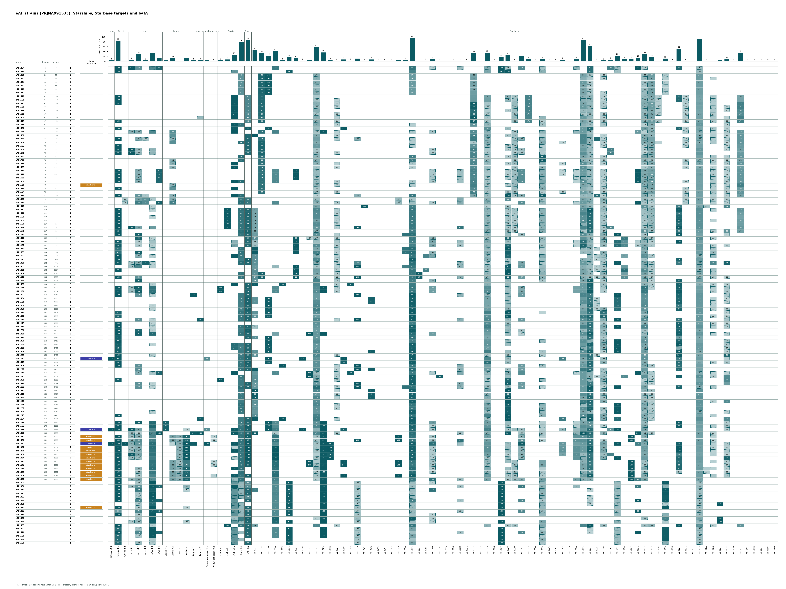

# eAF strains (PRJNA991533) with Starbase targets: Starship screen

135 isolates (0 local, counted but not listed), 107 clone groups (ANI 0.9995). Calls from the solo-hash rescreen: P present, p partial (an upper bound), - absent. Cuts raised: Osiris-h3 0.7, Janus-h4 0.7.

Heatmap: tint is the fraction of the element's specific hashes found; solid cells are present, dashed are partial. The PNG links to the PDF.

## bafA, all alleles

The `bafA` column below is the AF293-type allele (in the hrmA cluster). The all-alleles screen also finds divergent copies that sit outside that cluster:

| bafA class | Isolates | Clone groups |
|---|---:|---:|
| cluster-linked (AF293-type target present) | 3 | 3 of 107 |
| standalone divergent (all-alleles screen only) | 14 | 10 of 107 |
| no bafA | 118 | 94 of 107 |

## Per element

| Element | Present | Partial | Absent | Clone groups present |
|---|---:|---:|---:|---:|
| bafA | 3 | 0 | 132 | 3 of 107 |
| Gnosis-h1 | 85 | 0 | 50 | 69 of 107 |
| Gnosis-h2 | 1 | 2 | 132 | 1 of 107 |
| Janus-h1 | 6 | 15 | 114 | 5 of 107 |
| Janus-h2 | 30 | 34 | 71 | 28 of 107 |
| Janus-h3 | 3 | 2 | 130 | 3 of 107 |
| Janus-h4 | 32 | 36 | 67 | 27 of 107 |
| Janus-h5 | 12 | 0 | 123 | 10 of 107 |
| Lamia-h1 | 3 | 0 | 132 | 3 of 107 |
| Lamia-h2 | 13 | 8 | 114 | 10 of 107 |
| Lamia-h3 | 0 | 13 | 122 | 0 of 107 |
| Lamia-h4 | 13 | 5 | 117 | 9 of 107 |
| Logos-h1 | 3 | 0 | 132 | 3 of 107 |
| Logos-h2 | 3 | 1 | 131 | 3 of 107 |
| Nebuchadnezzar-h1 | 3 | 0 | 132 | 3 of 107 |
| Nebuchadnezzar-h2 | 0 | 5 | 130 | 0 of 107 |
| Osiris-h1 | 3 | 0 | 132 | 2 of 107 |
| Osiris-h2 | 7 | 0 | 128 | 3 of 107 |
| Osiris-h3 | 27 | 22 | 86 | 19 of 107 |
| Osiris-h4 | 79 | 12 | 44 | 60 of 107 |
| Tardis-h1 | 86 | 0 | 49 | 70 of 107 |

## Starbase targets

One representative per Starbase cluster that has none of our haplotypes, with at least 10 specific hashes and not core-like (`starbase_usable.py`). `uncertain` marks widespread targets that may or may not be real accessory elements. Store-wide is the count of isolates called present in the 4,849-isolate screen. No truth set exists for these targets, so every call is unvalidated.

| Target | Status | Length (kb) | Specific hashes | Store-wide isolates | eAF present | eAF partial | eAF clone groups |
|---|---|---:|---:|---:|---:|---:|---:|
| SBc004 | uncertain | 119 | 689 | 2,113 | 46 | 3 | 37 of 107 |
| SBc005 | usable | 61 | 287 | 1,540 | 33 | 0 | 20 of 107 |
| SBc006 | usable | 31 | 286 | 848 | 23 | 0 | 15 of 107 |
| SBc008 | usable | 56 | 37 | 1,101 | 42 | 2 | 35 of 107 |
| SBc009 | usable | 26 | 21 | 581 | 3 | 0 | 3 of 107 |
| SBc011 | usable | 73 | 121 | 120 | 17 | 0 | 17 of 107 |
| SBc014 | usable | 43 | 62 | 705 | 12 | 0 | 10 of 107 |
| SBc016 | usable | 49 | 11 | 112 | 2 | 0 | 2 of 107 |
| SBc017 | usable | 24 | 15 | 329 | 5 | 1 | 4 of 107 |
| SBc027 | uncertain | 24 | 30 | 2,487 | 57 | 60 | 46 of 107 |
| SBc029 | usable | 22 | 124 | 1,214 | 36 | 0 | 31 of 107 |
| SBc033 | usable | 78 | 354 | 93 | 5 | 0 | 4 of 107 |
| SBc034 | usable | 71 | 363 | 214 | 0 | 56 | 0 of 107 |
| SBc036 | usable | 117 | 581 | 375 | 7 | 0 | 6 of 107 |
| SBc038 | usable | 43 | 61 | 83 | 2 | 0 | 2 of 107 |
| SBc039 | usable | 182 | 28 | 438 | 11 | 19 | 10 of 107 |
| SBc042 | usable | 77 | 758 | 37 | 1 | 0 | 1 of 107 |
| SBc043 | usable | 26 | 60 | 71 | 7 | 0 | 4 of 107 |
| SBc046 | usable | 152 | 776 | 50 | 0 | 0 | 0 of 107 |
| SBc047 | usable | 32 | 348 | 9 | 0 | 0 | 0 of 107 |
| SBc048 | usable | 47 | 437 | 9 | 0 | 0 | 0 of 107 |
| SBc049 | usable | 54 | 74 | 43 | 5 | 2 | 3 of 107 |
| SBc050 | usable | 25 | 12 | 134 | 5 | 0 | 5 of 107 |
| SBc051 | uncertain | 184 | 322 | 3,501 | 95 | 23 | 75 of 107 |
| SBc054 | usable | 25 | 36 | 72 | 2 | 0 | 2 of 107 |
| SBc055 | usable | 24 | 22 | 106 | 2 | 0 | 2 of 107 |
| SBc060 | usable | 337 | 552 | 449 | 9 | 30 | 8 of 107 |
| SBc064 | usable | 62 | 555 | 15 | 1 | 0 | 1 of 107 |
| SBc065 | usable | 86 | 87 | 26 | 0 | 0 | 0 of 107 |
| SBc066 | usable | 24 | 35 | 302 | 0 | 0 | 0 of 107 |
| SBc068 | usable | 151 | 147 | 118 | 2 | 26 | 1 of 107 |
| SBc071 | usable | 77 | 92 | 113 | 0 | 0 | 0 of 107 |
| SBc072 | usable | 31 | 156 | 1,317 | 32 | 2 | 19 of 107 |
| SBc073 | usable | 24 | 20 | 173 | 0 | 0 | 0 of 107 |
| SBc075 | usable | 121 | 93 | 865 | 35 | 77 | 27 of 107 |
| SBc076 | usable | 23 | 32 | 12 | 0 | 0 | 0 of 107 |
| SBc077 | usable | 10 | 26 | 263 | 18 | 0 | 18 of 107 |
| SBc078 | usable | 3 | 21 | 1,496 | 26 | 65 | 22 of 107 |
| SBc079 | usable | 173 | 717 | 126 | 0 | 42 | 0 of 107 |
| SBc081 | usable | 324 | 164 | 785 | 22 | 17 | 19 of 107 |
| SBc083 | usable | 92 | 289 | 55 | 8 | 0 | 4 of 107 |
| SBc084 | usable | 84 | 220 | 9 | 0 | 0 | 0 of 107 |
| SBc085 | usable | 95 | 81 | 577 | 8 | 78 | 7 of 107 |
| SBc086 | usable | 21 | 29 | 2 | 0 | 0 | 0 of 107 |
| SBc087 | usable | 86 | 82 | 12 | 0 | 0 | 0 of 107 |
| SBc088 | usable | 90 | 263 | 94 | 6 | 6 | 5 of 107 |
| SBc089 | usable | 112 | 643 | 33 | 0 | 0 | 0 of 107 |
| SBc090 | usable | 401 | 527 | 200 | 10 | 15 | 7 of 107 |
| SBc091 | uncertain | 40 | 14 | 4,301 | 87 | 28 | 64 of 107 |
| SBc094 | usable | 113 | 186 | 1,985 | 62 | 62 | 47 of 107 |
| SBc095 | usable | 212 | 831 | 100 | 2 | 12 | 2 of 107 |
| SBc096 | usable | 30 | 72 | 175 | 3 | 87 | 2 of 107 |
| SBc097 | usable | 99 | 120 | 321 | 6 | 0 | 5 of 107 |
| SBc102 | usable | 22 | 94 | 862 | 23 | 18 | 20 of 107 |
| SBc104 | usable | 48 | 238 | 709 | 9 | 0 | 9 of 107 |
| SBc107 | usable | 65 | 74 | 53 | 8 | 0 | 5 of 107 |
| SBc111 | usable | 188 | 218 | 837 | 15 | 2 | 13 of 107 |
| SBc112 | uncertain | 80 | 109 | 2,320 | 30 | 88 | 25 of 107 |
| SBc113 | usable | 104 | 78 | 821 | 18 | 55 | 10 of 107 |
| SBc114 | usable | 31 | 63 | 3 | 0 | 8 | 0 of 107 |
| SBc115 | usable | 131 | 149 | 120 | 11 | 11 | 11 of 107 |
| SBc116 | usable | 155 | 848 | 4 | 0 | 0 | 0 of 107 |
| SBc117 | usable | 16 | 50 | 1,688 | 52 | 2 | 41 of 107 |
| SBc121 | usable | 24 | 62 | 20 | 0 | 22 | 0 of 107 |
| SBc122 | usable | 20 | 31 | 20 | 0 | 0 | 0 of 107 |
| SBc123 | uncertain | 155 | 273 | 3,348 | 93 | 42 | 66 of 107 |
| SBc124 | usable | 59 | 39 | 16 | 0 | 3 | 0 of 107 |
| SBc126 | usable | 85 | 81 | 232 | 1 | 68 | 1 of 107 |
| SBc127 | usable | 151 | 1495 | 5 | 3 | 0 | 3 of 107 |
| SBc128 | usable | 183 | 124 | 387 | 10 | 62 | 10 of 107 |
| SBc129 | usable | 98 | 16 | 53 | 0 | 0 | 0 of 107 |
| SBc131 | usable | 73 | 78 | 951 | 35 | 0 | 23 of 107 |
| SBc132 | usable | 141 | 262 | 21 | 0 | 0 | 0 of 107 |
| SBc133 | usable | 45 | 178 | 8 | 0 | 0 | 0 of 107 |
| SBc134 | usable | 30 | 33 | 9 | 0 | 0 | 0 of 107 |
| SBc136 | usable | 66 | 16 | 2 | 0 | 0 | 0 of 107 |
| SBc139 | usable | 16 | 36 | 22 | 0 | 0 | 0 of 107 |

## Per strain

| Strain | Lineage | Clone | bafA class | n | Present elements | Starbase n | Starbase targets present |
|---|---|---|---|---:|---|---:|---|
| eAF1454 | 5 | 6 | none | 4 | Gnosis-h1, Janus-h1, Janus-h2, Janus-h5 | 8 | SBc008, SBc051?, SBc077, SBc081, SBc094, SBc097, SBc111, SBc117 |
| eAF1673 | 5 | 10 | none | 1 | Gnosis-h1 | 5 | SBc011, SBc051?, SBc077, SBc078, SBc094 |
| eAF1436 | 28 | 56 | none | 1 | Osiris-h4 | 7 | SBc005, SBc006, SBc051?, SBc072, SBc091?, SBc113, SBc123? |
| eAF1442 | 28 | 56 | none | 1 | Osiris-h4 | 6 | SBc005, SBc006, SBc051?, SBc072, SBc113, SBc123? |
| eAF1444 | 28 | 56 | none | 1 | Osiris-h4 | 7 | SBc005, SBc006, SBc051?, SBc072, SBc091?, SBc113, SBc123? |
| eAF1447 | 28 | 56 | none | 1 | Osiris-h4 | 7 | SBc005, SBc006, SBc051?, SBc072, SBc091?, SBc113, SBc123? |
| eAF1448 | 28 | 56 | none | 1 | Osiris-h4 | 7 | SBc005, SBc006, SBc051?, SBc072, SBc091?, SBc113, SBc123? |
| eAF1453 | 28 | 56 | none | 1 | Osiris-h4 | 7 | SBc005, SBc006, SBc051?, SBc072, SBc091?, SBc113, SBc123? |
| eAF1548 | 67 | 258 | none | 3 | Gnosis-h1, Osiris-h3, Tardis-h1 | 7 | SBc005, SBc072, SBc075, SBc083, SBc117, SBc123?, SBc131 |
| eAF1555 | 67 | 258 | none | 3 | Gnosis-h1, Osiris-h3, Tardis-h1 | 7 | SBc005, SBc072, SBc075, SBc083, SBc117, SBc123?, SBc131 |
| eAF1515 | 67 | 259 | none | 3 | Gnosis-h1, Osiris-h3, Tardis-h1 | 7 | SBc005, SBc072, SBc083, SBc091?, SBc113, SBc123?, SBc131 |
| eAF1525 | 67 | 259 | none | 2 | Osiris-h3, Tardis-h1 | 7 | SBc005, SBc072, SBc083, SBc091?, SBc113, SBc123?, SBc131 |
| eAF1528 | 67 | 259 | none | 2 | Osiris-h3, Tardis-h1 | 5 | SBc005, SBc072, SBc083, SBc123?, SBc131 |
| eAF1529 | 67 | 259 | none | 2 | Osiris-h3, Tardis-h1 | 6 | SBc005, SBc072, SBc083, SBc113, SBc123?, SBc131 |
| eAF1500 | 67 | 260 | none | 2 | Osiris-h3, Tardis-h1 | 7 | SBc005, SBc072, SBc083, SBc091?, SBc113, SBc123?, SBc131 |
| eAF1519 | 67 | 261 | none | 2 | Gnosis-h1, Tardis-h1 | 7 | SBc005, SBc072, SBc083, SBc091?, SBc113, SBc123?, SBc131 |
| eAF1718 | 67 | 262 | none | 2 | Osiris-h3, Osiris-h4 | 2 | SBc072, SBc123? |
| eAF1530 | 67 | 263 | none | 3 | Gnosis-h1, Osiris-h3, Tardis-h1 | 7 | SBc006, SBc036, SBc075, SBc091?, SBc094, SBc112?, SBc117 |
| eAF1665 | 73 | 283 | none | 2 | Lamia-h2, Osiris-h3 | 7 | SBc005, SBc008, SBc029, SBc072, SBc091?, SBc111, SBc131 |
| eAF1460 | 73 | 288 | none | 2 | Lamia-h2, Tardis-h1 | 4 | SBc004?, SBc072, SBc091?, SBc131 |
| eAF1470 | 73 | 292 | none | 2 | Gnosis-h1, Tardis-h1 | 7 | SBc005, SBc027?, SBc072, SBc091?, SBc095, SBc113, SBc131 |
| eAF1459 | 78 | 390 | none | 3 | Lamia-h2, Osiris-h4, Tardis-h1 | 3 | SBc005, SBc091?, SBc131 |
| eAF1667 | 78 | 391 | none | 2 | Gnosis-h1, Tardis-h1 | 6 | SBc005, SBc027?, SBc072, SBc091?, SBc123?, SBc131 |
| eAF1668 | 78 | 399 | none | 3 | Gnosis-h1, Janus-h1, Tardis-h1 | 6 | SBc005, SBc072, SBc091?, SBc097, SBc123?, SBc131 |
| eAF1670 | 78 | 399 | none | 3 | Gnosis-h1, Janus-h1, Tardis-h1 | 6 | SBc005, SBc072, SBc091?, SBc097, SBc123?, SBc131 |
| eAF1467 | 78 | 461 | none | 1 | Osiris-h4 | 7 | SBc005, SBc051?, SBc072, SBc085, SBc091?, SBc123?, SBc131 |
| eAF1703 | 78 | 472 | none | 1 | Osiris-h4 | 5 | SBc005, SBc051?, SBc072, SBc085, SBc131 |
| eAF1458 | 78 | 476 | none | 1 | Osiris-h3 | 4 | SBc005, SBc072, SBc091?, SBc131 |
| eAF1535 | 78 | 476 | none | 1 | Osiris-h3 | 4 | SBc005, SBc072, SBc091?, SBc131 |
| eAF1469 | 78 | 484 | none | 2 | Gnosis-h1, Janus-h5 | 11 | SBc005, SBc008, SBc014, SBc072, SBc081, SBc091?, SBc111, SBc112?, SBc113, SBc123?, SBc131 |
| eAF1472 | 78 | 484 | none | 2 | Gnosis-h1, Janus-h5 | 10 | SBc005, SBc008, SBc014, SBc072, SBc081, SBc091?, SBc111, SBc113, SBc123?, SBc131 |
| eAF1669 | 78 | 484 | none | 2 | Gnosis-h1, Janus-h5 | 8 | SBc005, SBc008, SBc014, SBc072, SBc081, SBc111, SBc123?, SBc131 |
| eAF1468 | 78 | 532 | none | 4 | Gnosis-h1, Janus-h5, Osiris-h3, Osiris-h4 | 10 | SBc005, SBc008, SBc072, SBc081, SBc085, SBc091?, SBc111, SBc113, SBc123?, SBc131 |
| eAF1520 | 78 | 545 | standalone divergent | 0 |  | 6 | SBc005, SBc072, SBc091?, SBc113, SBc123?, SBc131 |
| eAF1576 | 78 | 567 | none | 3 | Gnosis-h1, Lamia-h2, Osiris-h3 | 5 | SBc005, SBc072, SBc113, SBc123?, SBc131 |
| eAF1504 | 78 | 603 | none | 0 |  | 6 | SBc005, SBc072, SBc091?, SBc113, SBc123?, SBc131 |
| eAF1685 | 83 | 656 | none | 4 | Gnosis-h1, Janus-h2, Osiris-h3, Osiris-h4 | 6 | SBc051?, SBc078, SBc085, SBc095, SBc123?, SBc131 |
| eAF1001 | 92 | 669 | none | 4 | Janus-h2, Janus-h3, Osiris-h4, Tardis-h1 | 3 | SBc078, SBc091?, SBc123? |
| eAF1014 | 92 | 672 | none | 6 | Janus-h2, Janus-h3, Janus-h5, Lamia-h2, Osiris-h4, Tardis-h1 | 5 | SBc008, SBc081, SBc091?, SBc111, SBc123? |
| eAF1547 | 115 | 721 | none | 0 |  | 7 | SBc027?, SBc042, SBc051?, SBc091?, SBc112?, SBc117, SBc128 |
| eAF1457 | 117 | 723 | none | 4 | Gnosis-h1, Osiris-h2, Osiris-h4, Tardis-h1 | 8 | SBc004?, SBc027?, SBc051?, SBc091?, SBc094, SBc117, SBc123?, SBc131 |
| eAF1572 | 117 | 723 | none | 4 | Gnosis-h1, Osiris-h2, Osiris-h4, Tardis-h1 | 8 | SBc004?, SBc027?, SBc051?, SBc091?, SBc094, SBc117, SBc123?, SBc131 |
| eAF1580 | 117 | 723 | none | 4 | Gnosis-h1, Osiris-h2, Osiris-h4, Tardis-h1 | 8 | SBc004?, SBc027?, SBc051?, SBc091?, SBc094, SBc117, SBc123?, SBc131 |
| eAF1664 | 117 | 723 | none | 4 | Gnosis-h1, Osiris-h2, Osiris-h4, Tardis-h1 | 8 | SBc004?, SBc027?, SBc051?, SBc091?, SBc094, SBc117, SBc123?, SBc131 |
| eAF1666 | 117 | 723 | none | 4 | Gnosis-h1, Osiris-h2, Osiris-h4, Tardis-h1 | 7 | SBc004?, SBc027?, SBc051?, SBc094, SBc117, SBc123?, SBc131 |
| eAF1649 | 117 | 724 | none | 5 | Gnosis-h1, Janus-h1, Osiris-h2, Osiris-h4, Tardis-h1 | 11 | SBc004?, SBc027?, SBc039, SBc051?, SBc068, SBc091?, SBc094, SBc097, SBc117, SBc123?, SBc131 |
| eAF1570 | 117 | 725 | none | 3 | Gnosis-h1, Osiris-h4, Tardis-h1 | 8 | SBc004?, SBc051?, SBc094, SBc112?, SBc117, SBc123?, SBc128, SBc131 |
| eAF1114 | 132 | 771 | none | 4 | Gnosis-h1, Janus-h2, Osiris-h4, Tardis-h1 | 8 | SBc004?, SBc027?, SBc050, SBc051?, SBc091?, SBc102, SBc117, SBc123? |
| eAF1510 | 132 | 772 | none | 2 | Janus-h2, Tardis-h1 | 7 | SBc004?, SBc014, SBc051?, SBc078, SBc091?, SBc104, SBc123? |
| eAF1478 | 132 | 773 | none | 2 | Gnosis-h1, Tardis-h1 | 8 | SBc014, SBc051?, SBc060, SBc091?, SBc102, SBc104, SBc117, SBc123? |
| eAF1107 | 132 | 774 | none | 2 | Gnosis-h1, Tardis-h1 | 9 | SBc014, SBc027?, SBc051?, SBc060, SBc078, SBc091?, SBc102, SBc104, SBc123? |
| eAF1361 | 134 | 855 | none | 2 | Gnosis-h1, Osiris-h4 | 7 | SBc004?, SBc014, SBc027?, SBc050, SBc051?, SBc078, SBc123? |
| eAF1659 | 134 | 856 | none | 3 | Gnosis-h1, Janus-h2, Osiris-h4 | 8 | SBc004?, SBc014, SBc027?, SBc050, SBc051?, SBc078, SBc112?, SBc123? |
| eAF1683 | 134 | 869 | none | 3 | Gnosis-h1, Osiris-h3, Osiris-h4 | 6 | SBc004?, SBc051?, SBc055, SBc078, SBc104, SBc112? |
| eAF1215 | 134 | 959 | none | 3 | Gnosis-h1, Osiris-h4, Tardis-h1 | 5 | SBc004?, SBc027?, SBc051?, SBc117, SBc123? |
| eAF1030 | 134 | 961 | none | 4 | Gnosis-h1, Janus-h3, Osiris-h4, Tardis-h1 | 9 | SBc004?, SBc039, SBc051?, SBc081, SBc091?, SBc102, SBc117, SBc126, SBc128 |
| eAF1305 | 134 | 1041 | none | 1 | Janus-h2 | 8 | SBc004?, SBc014, SBc039, SBc050, SBc051?, SBc078, SBc081, SBc104 |
| eAF1490 | 134 | 1054 | none | 1 | Gnosis-h1 | 9 | SBc004?, SBc014, SBc027?, SBc051?, SBc055, SBc078, SBc091?, SBc104, SBc112? |
| eAF1508 | 134 | 1059 | none | 1 | Osiris-h4 | 10 | SBc004?, SBc005, SBc014, SBc027?, SBc051?, SBc054, SBc078, SBc091?, SBc104, SBc112? |
| eAF1615 | 134 | 1063 | none | 3 | Gnosis-h1, Janus-h2, Osiris-h4 | 9 | SBc004?, SBc005, SBc014, SBc039, SBc051?, SBc054, SBc078, SBc081, SBc104 |
| eAF1349 | 134 | 1226 | none | 1 | Janus-h2 | 7 | SBc004?, SBc027?, SBc051?, SBc091?, SBc094, SBc117, SBc123? |
| eAF1461 | 134 | 1230 | none | 2 | Osiris-h3, Tardis-h1 | 8 | SBc004?, SBc009, SBc027?, SBc038, SBc051?, SBc091?, SBc094, SBc117 |
| eAF1175 | 146 | 1307 | none | 5 | Gnosis-h1, Janus-h2, Janus-h4, Osiris-h1, Tardis-h1 | 12 | SBc008, SBc027?, SBc029, SBc051?, SBc060, SBc075, SBc090, SBc091?, SBc094, SBc112?, SBc117, SBc123? |
| eAF1196 | 146 | 1307 | none | 5 | Gnosis-h1, Janus-h2, Janus-h4, Osiris-h1, Tardis-h1 | 12 | SBc008, SBc027?, SBc029, SBc051?, SBc060, SBc075, SBc090, SBc091?, SBc094, SBc112?, SBc117, SBc123? |
| eAF1083 | 150 | 1319 | none | 5 | Gnosis-h1, Janus-h2, Logos-h1, Osiris-h4, Tardis-h1 | 10 | SBc027?, SBc039, SBc051?, SBc081, SBc091?, SBc094, SBc102, SBc112?, SBc117, SBc123? |
| eAF1584 | 150 | 1335 | none | 2 | Osiris-h4, Tardis-h1 | 12 | SBc004?, SBc006, SBc027?, SBc043, SBc051?, SBc075, SBc091?, SBc094, SBc102, SBc112?, SBc117, SBc123? |
| eAF1596 | 150 | 1335 | none | 2 | Osiris-h4, Tardis-h1 | 12 | SBc004?, SBc006, SBc027?, SBc043, SBc051?, SBc075, SBc091?, SBc094, SBc102, SBc112?, SBc117, SBc123? |
| eAF1606 | 150 | 1336 | none | 2 | Osiris-h4, Tardis-h1 | 8 | SBc006, SBc027?, SBc051?, SBc094, SBc102, SBc112?, SBc117, SBc123? |
| eAF1086 | 150 | 1337 | none | 2 | Osiris-h4, Tardis-h1 | 10 | SBc006, SBc027?, SBc051?, SBc075, SBc091?, SBc094, SBc102, SBc112?, SBc117, SBc123? |
| eAF1280 | 150 | 1343 | none | 3 | Gnosis-h1, Osiris-h4, Tardis-h1 | 10 | SBc004?, SBc006, SBc027?, SBc051?, SBc075, SBc078, SBc091?, SBc094, SBc096, SBc123? |
| eAF1592 | 150 | 1343 | none | 3 | Gnosis-h1, Osiris-h4, Tardis-h1 | 10 | SBc004?, SBc006, SBc027?, SBc051?, SBc075, SBc078, SBc091?, SBc094, SBc096, SBc123? |
| eAF1130 | 150 | 1380 | none | 4 | Janus-h2, Logos-h2, Osiris-h4, Tardis-h1 | 11 | SBc027?, SBc039, SBc051?, SBc075, SBc081, SBc091?, SBc094, SBc102, SBc112?, SBc117, SBc123? |
| eAF1113 | 150 | 1396 | none | 1 | Gnosis-h1 | 7 | SBc027?, SBc051?, SBc075, SBc091?, SBc094, SBc117, SBc123? |
| eAF1010 | 150 | 1405 | none | 3 | Gnosis-h1, Osiris-h4, Tardis-h1 | 9 | SBc027?, SBc051?, SBc075, SBc091?, SBc094, SBc102, SBc112?, SBc117, SBc123? |
| eAF1700 | 150 | 1406 | none | 4 | Gnosis-h1, Janus-h2, Osiris-h4, Tardis-h1 | 5 | SBc027?, SBc051?, SBc075, SBc094, SBc117 |
| eAF1060 | 150 | 1407 | none | 5 | Gnosis-h1, Janus-h2, Janus-h4, Osiris-h4, Tardis-h1 | 11 | SBc008, SBc017, SBc027?, SBc029, SBc051?, SBc060, SBc075, SBc091?, SBc094, SBc117, SBc123? |
| eAF1319 | 150 | 1413 | none | 2 | Gnosis-h1, Tardis-h1 | 7 | SBc004?, SBc006, SBc027?, SBc051?, SBc094, SBc112?, SBc117 |
| eAF1306 | 150 | 1417 | none | 1 | Gnosis-h1 | 9 | SBc006, SBc027?, SBc051?, SBc075, SBc091?, SBc102, SBc112?, SBc117, SBc123? |
| eAF1150 | 150 | 1423 | none | 4 | Gnosis-h1, Osiris-h3, Osiris-h4, Tardis-h1 | 10 | SBc006, SBc027?, SBc051?, SBc075, SBc091?, SBc094, SBc102, SBc112?, SBc117, SBc123? |
| eAF1428 | 150 | 1423 | none | 4 | Gnosis-h1, Osiris-h3, Osiris-h4, Tardis-h1 | 7 | SBc006, SBc027?, SBc051?, SBc075, SBc094, SBc102, SBc123? |
| eAF1368 | 150 | 1426 | none | 3 | Gnosis-h1, Osiris-h4, Tardis-h1 | 11 | SBc004?, SBc006, SBc027?, SBc043, SBc051?, SBc075, SBc091?, SBc094, SBc102, SBc112?, SBc117 |
| eAF1209 | 150 | 1433 | none | 3 | Gnosis-h1, Osiris-h4, Tardis-h1 | 9 | SBc004?, SBc027?, SBc051?, SBc091?, SBc094, SBc112?, SBc117, SBc123?, SBc128 |
| eAF1177 | 150 | 1480 | cluster linked | 5 | bafA, Gnosis-h1, Nebuchadnezzar-h1, Osiris-h4, Tardis-h1 | 12 | SBc006, SBc016, SBc027?, SBc036, SBc051?, SBc075, SBc088, SBc091?, SBc094, SBc112?, SBc117, SBc123? |
| eAF1619 | 150 | 1491 | none | 3 | Gnosis-h1, Osiris-h4, Tardis-h1 | 8 | SBc006, SBc027?, SBc036, SBc051?, SBc075, SBc091?, SBc094, SBc117 |
| eAF1205 | 150 | 1495 | none | 4 | Gnosis-h1, Janus-h2, Osiris-h4, Tardis-h1 | 10 | SBc009, SBc027?, SBc039, SBc051?, SBc075, SBc081, SBc091?, SBc094, SBc117, SBc123? |
| eAF1227 | 150 | 1496 | none | 3 | Janus-h2, Osiris-h4, Tardis-h1 | 12 | SBc004?, SBc027?, SBc039, SBc043, SBc051?, SBc075, SBc081, SBc091?, SBc094, SBc112?, SBc117, SBc123? |
| eAF1110 | 150 | 1498 | none | 2 | Janus-h5, Osiris-h3 | 8 | SBc004?, SBc008, SBc017, SBc038, SBc051?, SBc081, SBc091?, SBc111 |
| eAF1125 | 150 | 1501 | none | 1 | Osiris-h4 | 10 | SBc004?, SBc017, SBc051?, SBc064, SBc091?, SBc104, SBc112?, SBc117, SBc123?, SBc128 |
| eAF1068 | 150 | 1505 | none | 3 | Gnosis-h1, Osiris-h1, Osiris-h4 | 6 | SBc004?, SBc051?, SBc078, SBc091?, SBc123?, SBc128 |
| eAF1376 | 150 | 1679 | none | 3 | Janus-h2, Osiris-h4, Tardis-h1 | 10 | SBc004?, SBc027?, SBc039, SBc051?, SBc078, SBc081, SBc091?, SBc094, SBc123?, SBc128 |
| eAF1153 | 150 | 1709 | none | 3 | Janus-h2, Osiris-h4, Tardis-h1 | 11 | SBc004?, SBc027?, SBc039, SBc050, SBc051?, SBc081, SBc091?, SBc094, SBc102, SBc112?, SBc117 |
| eAF1392 | 150 | 1712 | none | 1 | Osiris-h4 | 8 | SBc004?, SBc027?, SBc043, SBc051?, SBc078, SBc091?, SBc094, SBc123? |
| eAF1416 | 150 | 1712 | none | 1 | Osiris-h4 | 8 | SBc004?, SBc027?, SBc043, SBc051?, SBc078, SBc091?, SBc094, SBc123? |
| eAF1420 | 150 | 1712 | none | 1 | Osiris-h4 | 8 | SBc004?, SBc027?, SBc043, SBc051?, SBc078, SBc091?, SBc094, SBc123? |
| eAF1178 | 150 | 1713 | none | 1 | Osiris-h4 | 8 | SBc004?, SBc027?, SBc051?, SBc078, SBc091?, SBc094, SBc123?, SBc128 |
| eAF1145 | 150 | 1714 | none | 1 | Osiris-h4 | 7 | SBc004?, SBc027?, SBc051?, SBc078, SBc094, SBc102, SBc123? |
| eAF1267 | 150 | 1714 | none | 1 | Osiris-h4 | 9 | SBc004?, SBc027?, SBc051?, SBc075, SBc078, SBc091?, SBc094, SBc102, SBc123? |
| eAF1426 | 150 | 1715 | none | 1 | Osiris-h4 | 6 | SBc004?, SBc027?, SBc051?, SBc078, SBc091?, SBc102 |
| eAF1245 | 150 | 1716 | none | 1 | Gnosis-h1 | 8 | SBc004?, SBc027?, SBc051?, SBc075, SBc078, SBc091?, SBc094, SBc123? |
| eAF1154 | 150 | 1721 | none | 3 | Logos-h2, Osiris-h4, Tardis-h1 | 10 | SBc004?, SBc009, SBc027?, SBc051?, SBc078, SBc088, SBc094, SBc102, SBc123?, SBc128 |
| eAF1719 | 173 | 1835 | none | 6 | Gnosis-h1, Janus-h2, Janus-h4, Lamia-h1, Osiris-h4, Tardis-h1 | 11 | SBc006, SBc008, SBc027?, SBc029, SBc051?, SBc060, SBc075, SBc091?, SBc094, SBc117, SBc123? |
| eAF1502 | 173 | 1856 | none | 5 | Gnosis-h1, Janus-h4, Lamia-h1, Osiris-h4, Tardis-h1 | 10 | SBc006, SBc008, SBc027?, SBc029, SBc051?, SBc075, SBc091?, SBc094, SBc117, SBc123? |
| eAF1018 | 178 | 1881 | cluster linked | 10 | bafA, Gnosis-h1, Janus-h1, Janus-h2, Janus-h4, Lamia-h1, Nebuchadnezzar-h1, Osiris-h3, Osiris-h4, Tardis-h1 | 13 | SBc006, SBc008, SBc016, SBc029, SBc036, SBc051?, SBc075, SBc091?, SBc094, SBc097, SBc102, SBc112?, SBc123? |
| eAF1085 | 190 | 1928 | none | 6 | Janus-h5, Logos-h1, Logos-h2, Osiris-h3, Osiris-h4, Tardis-h1 | 9 | SBc004?, SBc027?, SBc029, SBc051?, SBc078, SBc091?, SBc094, SBc111, SBc123? |
| eAF1082 | 191 | 1929 | standalone divergent | 5 | Gnosis-h1, Lamia-h2, Lamia-h4, Osiris-h4, Tardis-h1 | 10 | SBc008, SBc029, SBc049, SBc051?, SBc075, SBc090, SBc091?, SBc094, SBc107, SBc123? |
| eAF1430 | 191 | 1929 | standalone divergent | 7 | Gnosis-h1, Janus-h2, Janus-h4, Lamia-h2, Lamia-h4, Osiris-h4, Tardis-h1 | 13 | SBc008, SBc029, SBc039, SBc049, SBc051?, SBc068, SBc075, SBc081, SBc090, SBc091?, SBc094, SBc107, SBc123? |
| eAF1577 | 191 | 1933 | cluster linked | 11 | bafA, Gnosis-h1, Gnosis-h2, Janus-h2, Janus-h4, Lamia-h4, Logos-h1, Nebuchadnezzar-h1, Osiris-h3, Osiris-h4, Tardis-h1 | 16 | SBc008, SBc029, SBc033, SBc051?, SBc060, SBc075, SBc081, SBc088, SBc090, SBc091?, SBc094, SBc096, SBc102, SBc111, SBc117, SBc123? |
| eAF1092 | 191 | 1934 | standalone divergent | 5 | Gnosis-h1, Janus-h4, Lamia-h4, Osiris-h4, Tardis-h1 | 12 | SBc008, SBc029, SBc033, SBc051?, SBc075, SBc088, SBc090, SBc091?, SBc094, SBc112?, SBc117, SBc123? |
| eAF1435 | 191 | 1934 | standalone divergent | 6 | Gnosis-h1, Janus-h4, Lamia-h4, Osiris-h3, Osiris-h4, Tardis-h1 | 12 | SBc008, SBc029, SBc033, SBc051?, SBc075, SBc088, SBc090, SBc091?, SBc094, SBc112?, SBc117, SBc123? |
| eAF1562 | 191 | 1935 | standalone divergent | 7 | Gnosis-h1, Janus-h1, Janus-h2, Janus-h4, Lamia-h4, Osiris-h4, Tardis-h1 | 11 | SBc008, SBc029, SBc033, SBc051?, SBc075, SBc088, SBc090, SBc094, SBc097, SBc117, SBc123? |
| eAF1054 | 191 | 1936 | standalone divergent | 5 | Gnosis-h1, Janus-h4, Lamia-h4, Osiris-h4, Tardis-h1 | 11 | SBc008, SBc029, SBc033, SBc051?, SBc090, SBc094, SBc102, SBc112?, SBc117, SBc123?, SBc128 |
| eAF1075 | 193 | 1956 | standalone divergent | 6 | Gnosis-h1, Janus-h4, Lamia-h2, Lamia-h4, Osiris-h4, Tardis-h1 | 11 | SBc008, SBc017, SBc029, SBc036, SBc049, SBc051?, SBc085, SBc094, SBc107, SBc117, SBc123? |
| eAF1141 | 193 | 1956 | standalone divergent | 6 | Gnosis-h1, Janus-h4, Lamia-h2, Lamia-h4, Osiris-h4, Tardis-h1 | 12 | SBc008, SBc017, SBc029, SBc036, SBc049, SBc051?, SBc085, SBc091?, SBc094, SBc107, SBc117, SBc123? |
| eAF1126 | 193 | 1957 | standalone divergent | 6 | Gnosis-h1, Janus-h4, Lamia-h2, Lamia-h4, Osiris-h3, Osiris-h4 | 8 | SBc008, SBc029, SBc051?, SBc091?, SBc094, SBc107, SBc117, SBc123? |
| eAF1473 | 193 | 1957 | standalone divergent | 5 | Gnosis-h1, Janus-h4, Lamia-h2, Lamia-h4, Osiris-h4 | 6 | SBc008, SBc029, SBc051?, SBc094, SBc107, SBc123? |
| eAF1008 | 193 | 1958 | standalone divergent | 7 | Gnosis-h1, Janus-h4, Lamia-h2, Lamia-h4, Osiris-h3, Osiris-h4, Tardis-h1 | 10 | SBc008, SBc029, SBc036, SBc049, SBc051?, SBc075, SBc091?, SBc094, SBc107, SBc123? |
| eAF1057 | 193 | 1960 | standalone divergent | 4 | Gnosis-h1, Lamia-h2, Lamia-h4, Osiris-h4 | 9 | SBc008, SBc029, SBc051?, SBc060, SBc085, SBc090, SBc107, SBc111, SBc123? |
| eAF1003 |  |  | none | 3 | Gnosis-h1, Janus-h4, Tardis-h1 | 5 | SBc008, SBc011, SBc029, SBc077, SBc115 |
| eAF1006 |  |  | none | 6 | Gnosis-h1, Janus-h2, Janus-h4, Janus-h5, Osiris-h3, Tardis-h1 | 6 | SBc008, SBc011, SBc029, SBc077, SBc081, SBc111 |
| eAF1011 |  |  | none | 4 | Gnosis-h1, Janus-h2, Janus-h4, Tardis-h1 | 7 | SBc004?, SBc008, SBc011, SBc029, SBc060, SBc077, SBc115 |
| eAF1015 |  |  | none | 3 | Gnosis-h1, Janus-h4, Tardis-h1 | 5 | SBc008, SBc011, SBc029, SBc077, SBc115 |
| eAF1023 |  |  | none | 3 | Gnosis-h1, Janus-h4, Tardis-h1 | 5 | SBc008, SBc011, SBc029, SBc077, SBc115 |
| eAF1090 |  |  | none | 5 | Gnosis-h1, Janus-h2, Janus-h4, Janus-h5, Tardis-h1 | 8 | SBc008, SBc011, SBc029, SBc051?, SBc077, SBc081, SBc111, SBc115 |
| eAF1350 |  |  | none | 1 | Janus-h4 | 5 | SBc008, SBc011, SBc029, SBc077, SBc127 |
| eAF1432 |  |  | standalone divergent | 3 | Gnosis-h1, Janus-h4, Tardis-h1 | 5 | SBc008, SBc011, SBc029, SBc077, SBc115 |
| eAF1433 |  |  | none | 5 | Gnosis-h1, Janus-h2, Janus-h4, Janus-h5, Tardis-h1 | 6 | SBc008, SBc011, SBc029, SBc077, SBc081, SBc111 |
| eAF1434 |  |  | none | 3 | Gnosis-h1, Janus-h4, Tardis-h1 | 4 | SBc008, SBc011, SBc029, SBc077 |
| eAF1438 |  |  | none | 3 | Janus-h4, Osiris-h4, Tardis-h1 | 5 | SBc008, SBc029, SBc051?, SBc115, SBc127 |
| eAF1449 |  |  | none | 2 | Janus-h4, Tardis-h1 | 6 | SBc008, SBc011, SBc029, SBc077, SBc085, SBc127 |
| eAF1465 |  |  | none | 4 | Gnosis-h1, Osiris-h2, Osiris-h4, Tardis-h1 | 8 | SBc004?, SBc027?, SBc051?, SBc091?, SBc094, SBc117, SBc123?, SBc131 |
| eAF1482 |  |  | none | 3 | Gnosis-h1, Janus-h4, Tardis-h1 | 6 | SBc008, SBc011, SBc029, SBc051?, SBc077, SBc115 |
| eAF1546 |  |  | none | 5 | Gnosis-h1, Janus-h2, Janus-h4, Janus-h5, Tardis-h1 | 7 | SBc008, SBc011, SBc029, SBc077, SBc081, SBc111, SBc115 |
| eAF1560 |  |  | none | 3 | Gnosis-h1, Janus-h4, Tardis-h1 | 6 | SBc008, SBc011, SBc029, SBc051?, SBc077, SBc115 |
| eAF1638 |  |  | none | 1 | Gnosis-h1 | 3 | SBc011, SBc077, SBc115 |
| eAF1650 |  |  | none | 2 | Gnosis-h1, Tardis-h1 | 3 | SBc011, SBc051?, SBc077 |
